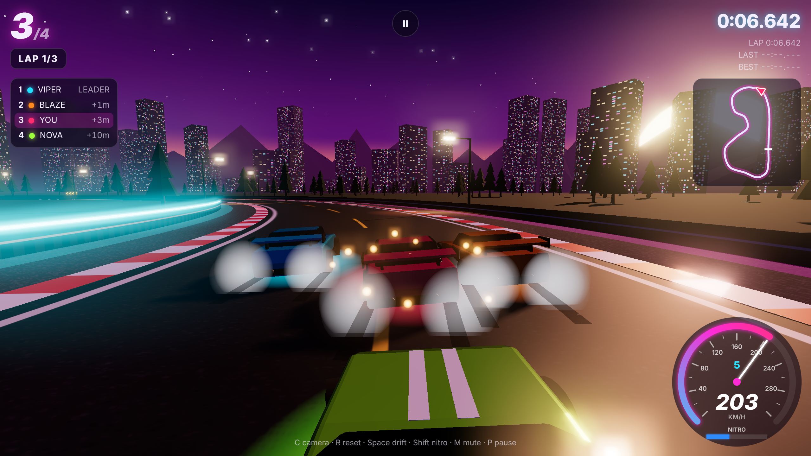

# Neon Velocity

A high-visual 3D arcade racing game that runs in the browser, built with
[Three.js](https://threejs.org). Race three AI rivals around a neon-lit
sunset circuit: drift to charge your nitro, then boost down the straights.



## Play

```bash
npm install      # only needed for the tests; the game itself has no build step
npm start        # serves the game on http://localhost:4173
```

Any static file server works too (the game is plain ES modules; Three.js is
vendored in `vendor/three`, so nothing is fetched from a CDN).

### Controls

| Action | Keyboard | Gamepad | Touch |
| --- | --- | --- | --- |
| Accelerate | `W` / `↑` | RT | ▲ |
| Brake / reverse | `S` / `↓` | LT | ▼ |
| Steer | `A` `D` / `←` `→` | Left stick | ◀ ▶ |
| Handbrake drift | `Space` | B | DRIFT |
| Nitro | `Shift` / `N` | A | ⚡ |
| Camera (chase / far / hood) | `C` | | |
| Reset car to track | `R` | | |
| Pause | `P` / `Esc` | | II |
| Mute | `M` | | |

## Features

- **Visuals:** HDR rendering with ACES tone mapping, a bloom pass, soft
  shadows, a procedural synthwave sky (striped sun, stars) that also lights
  the clear-coat car paint through its reflections, neon barriers, street
  lamps that light the road, a city skyline, mountains, forests and a cheering
  grandstand.
- **Cars:** procedural sports cars with spinning and steering wheels, body
  roll, brake lights, headlights, coloured underglow and nitro flames.
- **Effects:** tyre smoke, off-road dust, impact sparks, skid marks that stay
  on the track, camera shake, and FOV that widens with speed.
- **Gameplay:** arcade physics with grip, handbrake drifts and barrier
  collisions. Drifting fills the nitro tank faster. Three AI rivals follow a
  racing line, plan their braking, overtake each other and use nitro.
- **Modes:** Grand Prix (four cars) or solo Time Trial; 1, 3 or 5 laps; Easy,
  Normal or Hard AI.
- **HUD:** live positions with gaps, lap and best-lap timers, an animated
  speedometer with gear and nitro readout, a minimap, start lights and a
  countdown, a wrong-way warning, and a results screen.
- **Sound:** all audio is synthesised with WebAudio (engine RPM with gear
  changes, tyre screech, wind, impacts, countdown beeps).
- **Settings:** paint colour, mode, difficulty, laps and graphics quality are
  remembered, along with your best lap and race times.

## Tests

The end-to-end suite drives the real game in Chromium with Playwright. WebGL
runs on SwiftShader, a software renderer, so the tests also pass on machines
with no GPU.

```bash
npm install
npx playwright install chromium   # skip if Chromium is already installed
npm test
```

What the tests cover:

| Area | What is checked |
| --- | --- |
| Boot and rendering | No console errors; the WebGL output is a lit, varied scene (pixel sampling), not a blank screen |
| Menu | Paint, mode, difficulty and laps buttons respond, and the choices survive a page reload |
| Driving | The real-time countdown, then keyboard throttle, steering and braking |
| Pause | Pausing freezes the race clock; Resume continues it; Restart begins a new countdown |
| Hotkeys | Camera cycling, mute, and resetting the car to the track |
| Physics | Barriers keep the car on the track; nitro gives a measurable speed boost |
| AI | All rivals drive inside the track at racing speed, and the live leaderboard updates |
| Warnings | Driving the wrong way shows a warning |
| Full race | A complete race ends on the results screen, best times are saved, and Race Again works |
| Time Trial | A solo lap ends on a TIME TRIAL result |
| Mobile | Touch buttons work on a Pixel 7 viewport, with no horizontal scrolling |

For tests and automation, the page exposes `window.__game`
(`getState()`, `simulate(seconds, opts)`, `teleport()`, `snapshotStats()`).
`simulate()` runs the same fixed-step (120 Hz) simulation the game loop uses,
without rendering, so a full race can be checked in seconds.

## Project layout

```
index.html          UI shell, styles, import map
server.js           zero-dependency static server (npm start)
src/main.js         renderer, post-processing, input, UI, game loop, test hooks
src/race.js         race manager: grid, countdown, laps, standings, results
src/physics.js      car physics, AI driver, car-to-car collisions
src/track.js        circuit spline, sampling, nearest-point queries
src/world.js        sky, lighting, road, curbs, barriers, scenery
src/carModel.js     procedural car mesh
src/effects.js      particle system and skid marks
src/audio.js        synthesised sound
src/hud.js          speedometer and minimap
tests/game.spec.js  Playwright end-to-end tests
vendor/three/       Three.js r170 (MIT) and the post-processing add-ons it needs
```
